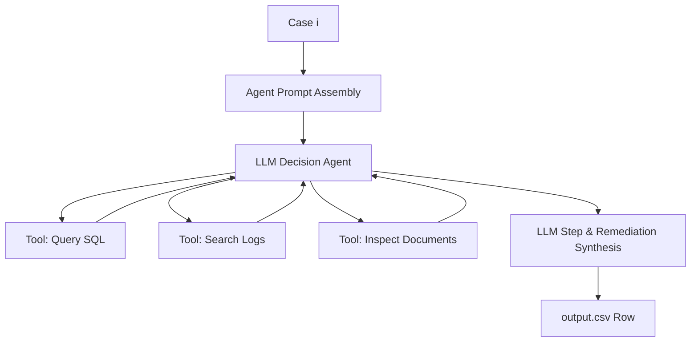

# System Architecture: Ghost Data Still Exists Deletion-Audit Agent

This document defines the architectural designs, component contracts, data flows, and trade-offs for the **Ghost Data Still Exists** deletion-audit system.

---

## 1. Core Design Philosophy

1. **Deterministic where possible, probabilistic only where strictly necessary**:
   - Identity graph resolution, SQL replica comparison, structured log indexing, activity claim verification, policy rules evaluation, step sorting, and invariant validation must be implemented in **100% deterministic code**.
   - Language Model (LLM) calls are restricted strictly to:
     1. Semantic extraction of unstructured artifacts: the 11 PNG screenshots and 4 PDF documents.
     2. Multilingual intent validation for requests not matching standard English templates.
2. **Absolute Temporal Integrity**:
   - Evidence timestamped after a case's `audit_at` must never be observed during that case's state reconstruction.
3. **On-Disk Caching & Idempotency**:
   - Every LLM response is cached to disk under `code/cache/llm/` keyed by the SHA-256 hash of the input file or prompt. Repeated runs execute without network calls or token consumption.
4. **Zero Sample-Answer Leakage & Zero Label Hardcoding**:
   - Predictions are derived strictly from evidence, identities, and policy rules. No case family shortcuts or hardcoded outputs.

---

## 2. Architecture Comparison & Trade-Offs

### Option 1: Decoupled Pre-Index & Multi-Pass Deterministic Auditor (Recommended)

```mermaid
flowchart TD
    subgraph Offline_Pass["Pass 1: Offline Pre-Indexing & Unstructured Extraction"]
        PDFs[4 PDFs] --> LLM_Ext[LLM Vision/Document Extractor]
        PNGs[11 PNGs] --> LLM_Ext
        LLM_Ext --> DiskCache[(Disk Cache: code/cache/unstructured.json)]
        SQL[24 SQL Files] --> SQL_Parser[Deterministic SQL Loader & Diff Engine]
        Logs[26 Logs + 29 Records] --> Log_Parser[Log & Record Parser]
        SQL_Parser --> Evidence_DB[(In-Memory Evidence Index)]
        Log_Parser --> Evidence_DB
        DiskCache --> Evidence_DB
    end

    subgraph PerCase_Pass["Pass 2: Deterministic Per-Case State Reconstruction"]
        Req[deletion_requests.csv] --> IntentCheck{Intent Filter}
        IntentCheck -- "Non-Deletion" --> NA[NOT_APPLICABLE / steps=[]]
        IntentCheck -- "Deletion" --> IdResolve[Identity Graph Resolver]
        IdResolve --> CutoffFilter[Temporal Cutoff: captured_at <= audit_at]
        CutoffFilter --> PolicyEngine[Deterministic Policy Engine]
        PolicyEngine --> StepGen[Step Generator: FINDING / REMEDIATION / VERIFICATION]
    end

    subgraph Verification_Pass["Pass 3: Contract Validation & Output"]
        StepGen --> Sorter[4-Tuple Deterministic Sorter]
        Sorter --> Linter[10 Invariant Contract Validator]
        NA --> OutputWriter
        Linter --> OutputWriter[Output CSV Writer]
        OutputWriter --> OutCSV[output.csv]
    end
```

#### How Option 1 Works
1. **Pass 1 (One-Time Indexing & Extraction)**:
   - The 15 unstructured files (11 images, 4 PDFs) are analyzed once via LLM with strict JSON schemas. The structured findings (user IDs, legal hold dates, tombstone formats) are saved to `code/cache/unstructured_evidence.json`.
   - The 24 SQL databases, 26 logs, and 29 record files are parsed once into structured memory tables indexed by `(resource_id, user_id, timestamp, system_id)`.
2. **Pass 2 (Per-Case Deterministic Audit)**:
   - Request text is checked for deletion authorization. If non-deletion (`case_533`–`case_542`), immediately output `NOT_APPLICABLE` with `[]`.
   - For deletion cases:
     - Expand request email into full identity set (current/historical emails, phones, SHA-256 hashes, `user_id`, `customer_reference`).
     - Query pre-indexed evidence strictly filtering `captured_at <= audit_at`.
     - Detect primary vs. replica drift (e.g. `customer_profiles_failover_replica`).
     - Evaluate `deletion_rules.csv` against observed state.
     - Detect active synchronization flows and restore risks from `system_activity.csv`.
     - Formulate `FINDING`s, safe ordered `REMEDIATION`s, and `VERIFICATION`s.
3. **Pass 3 (Sorting & Verification)**:
   - Apply sort key: `(phase_rank, operation_rank, system_id ASC, resource_id ASC)`.
   - Re-index `step_no` sequentially from 1.
   - Run invariant linter against `docs/CONTRACT.md`.
   - Write `output.csv`.

---

### Option 2: Dynamic Agentic Evaluation Loop



#### How Option 2 Works
- For every case (518 times), an agent loop is invoked with access to search tools over evidence, activity, and identities.
- The agent decides which evidence to query, interprets retention rules dynamically, and generates JSON steps directly.

---

### Trade-Off Analysis Matrix

| Criterion | Option 1: Multi-Pass Deterministic Auditor | Option 2: Dynamic Agentic Loop |
|---|---|---|
| **Determinism & Reproducibility** | **100% Deterministic**. Identical input guaranteed to produce bit-for-bit identical output. | **Low**. Prone to hallucinated steps, schema drifts, and stochastic ordering. |
| **Token Usage & Cost** | **Minimal** (Estimated ~15 calls total for unstructured extraction, ~10k-20k tokens total, <$0.05; *estimates to be measured empirically, not facts*). | **Massive** (518 cases × multi-turn tools = estimated 2M–10M tokens, $10–$50+; *estimate*). |
| **Execution Time** | **Fast** (Estimated < 15 seconds for all 518 cases after cache warming; *estimate to be measured during benchmark runs*). | **Slow** (Estimated 30 to 90 minutes due to sequential API roundtrips; *estimate*). |
| **Step Ordering Precision** | **Guaranteed exact** compliance with `docs/CONTRACT.md` 4-tuple sort key. | **High risk** of phase mixing or arbitrary operation order. |
| **Bug Isolation & Debuggability** | **Trivial**. Rules and database diffs can be unit-tested individually. | **Difficult**. Failures buried in LLM chain-of-thought traces. |
| **Maintenance & Portability** | Zero ongoing external dependencies once evidence cache is generated. | Requires constant active network access and API credentials. |

---

## 3. Selected Architecture: Option 1 Core + Bounded Investigator Loop

**Decision**: **Option 1 as the core pipeline, augmented with a bounded investigator loop for hard cases only.**

### Rationale
The task demands exact, repeatable ordering, strict schema adherence, and unambiguous policy enforcement. Deterministic code must execute identity resolution, database replica comparisons, retention rule application, and step sorting to guarantee zero hallucinations and perfect sequence reproducibility. 

However, edge-case evidence (such as unstructured support attachments, ambiguous legal hold tables, or unindexed logs) requires tool-assisted semantic reading. A bounded investigator loop handles these ambiguous cases without compromising the deterministic integrity of the rest of the pipeline.

### The Bounded Investigator Loop Specification
- **Trigger Condition**: Activated strictly when deterministic evidence parsing flags an unresolved ambiguity (e.g., an unindexed attachment mentioned in a support ticket, or an ambiguous date format in a PDF).
- **Tool Access**: The sub-agent has read-only access to specific file-reading tools (`read_file`, `extract_table`).
- **Bounded Constraints**:
  - Max tool steps per hard case: **3 steps**.
  - Hard case cap across full run: **<= 10 cases**.
  - Output constraint: The investigator does NOT generate steps or decisions directly. It outputs a strictly typed JSON fact dictionary (e.g. `{"resource_present": bool, "hold_expires_at": "2027-08-25", "evidence_id": "evidence_58"}`).
  - The deterministic policy engine consumes these facts and applies the invariant-compliant rules and sort keys.

---

## 4. Component Deep Dives

### 4.1 Intent & Multilingual Request Classifier
- **Module**: `code/intent_filter.py`
- **Methodology**:
  - Deterministic matcher for English request templates.
  - Regex negation validator detecting qualifiers ("not asking for deletion", "Do not close", "without removing", "marketing lists only", "not a request to erase", "don't delete").
  - Template cache for verified multilingual templates (French, Spanish, Japanese, Korean, Portuguese).
  - LLM fallback with strict boolean schema `{"authorizes_deletion": bool, "reason": str}` only invoked if an unseen non-English text is encountered.

### 4.2 Identity Graph Resolver
- **Module**: `code/identity_resolver.py`
- **Methodology**:
  - Loads `dataset/user_identities.csv` and `dataset/user_audit_log.csv`.
  - Builds an in-memory index mapping any identifier (historical email, current email, phone, SHA-256 lowercase email hash, `customer_reference`) to a unified `user_id`.
  - Normalizes emails to lowercase before hashing or matching, while preserving original values for raw log searches.

### 4.3 Evidence Pre-Indexer & Topology Engine
- **Module**: `code/evidence_index.py`
- **Methodology**:
  - **SQL Snapshots**: Loads SQL files into SQLite in-memory databases. Compares primary vs replica tables (failover, reporting, regional) to detect replication drift.
  - **Logs**: Parses structured log files (readback trace logs `resource_lookup_trace_*.log`, runtime export logs, webserver access logs) extracting `(timestamp, system_id, resource_id, user_identifiers, status)`.
  - **Records**: Parses JSON records from `evidence/records/` into typed dictionaries.
  - **Unstructured Cache**: Reads `cache/unstructured_evidence.json` (containing retention periods, legal hold registers from PDFs, and tombstone formats from screenshots).

### 4.4 Policy Evaluation & Step Synthesizer
- **Module**: `code/policy_engine.py`
- **Methodology**:
  - Evaluates `deletion_rules.csv` against current resource state at `audit_at`:
    - **RULE_12 (SECURITY_AUDIT_LOG -> RETAIN)**: Retain security audit logs. In COMPLETE cases, emit `VERIFY_RECORD_PRESENT`.
    - **RULE_15 (ACCOUNT_TOMBSTONE -> REDACT)**: Account tombstone must retain `user_id` but strip direct PII.
    - **Legal Holds**: If user is listed in `legal_retention_register_20260529.pdf` with active retain date, order records must be retained.
    - **Active Sync Flows**: Inspect `system_activity.csv` for enabled data flows (`CHECK_DATA_FLOW`) or recent sync events. If active, emit `REPORT_ACTIVE_DATA_FLOW` -> `DISABLE_DATA_FLOW` -> `VERIFY_DATA_FLOW_DISABLED`.
    - **Restore Risks**: Inspect for backups capable of repopulating user data (`CHECK_RESTORE_ACCESS`). If active, emit `REPORT_RESTORE_RISK` -> `BLOCK_RESTORE` -> `VERIFY_RESTORE_BLOCKED`.
    - **Ghost Records**: If a record exists in primary or replica that should have been deleted, emit `REPORT_REMAINING_RECORD` -> `DELETE_RECORD` -> `VERIFY_RECORD_ABSENT`.

### 4.5 Step Sorter & Invariant Linter
- **Module**: `code/step_sorter.py` and `code/validator.py`
- **Methodology**:
  - Sorts every step array strictly by `(phase_rank, operation_rank, system_id ASC, resource_id ASC)`.
  - Assigns consecutive `step_no` (1 to N).
  - Validates all 10 invariants from `docs/CONTRACT.md`.
  - Serializes to RFC-4180 compliant CSV.

---

## 5. LLM Client Wrapper Design & Token Usage Ledger

### 5.1 Three-Key Disk Caching: `(prompt_version, model, input_hash)`
Every call to an LLM must pass through the `LLMClient` wrapper (`code/llm_client.py`).
- **Cache Key Formulation**:
  ```text
  cache_key = sha256(f"{prompt_version}:{model_name}:{sha256(input_content)}")
  cache_path = f"code/cache/llm/{prompt_version}_{model_name}_{input_hash[:16]}.json"
  ```
- **Cache Hit**: Returns stored response without network call or token consumption.
- **Cache Miss**: Executes API call, validates response against JSON schema, saves full payload to disk, and updates the usage ledger.

### 5.2 Append-Only Usage Ledger (`code/cache/llm/usage_ledger.jsonl`)
Every single LLM call (cached or fresh) appends an immutable line to the ledger:
```json
{
  "timestamp": "2026-10-24T19:25:00Z",
  "call_id": "call_0004",
  "caller": "pdf_extractor",
  "provider": "google",
  "model": "Gemini 3.8 Flash High",
  "prompt_version": "v1.0",
  "input_hash": "e3b0c44298fc1c149afbf4c8996fb92427ae41e4649b934ca495991b7852b855",
  "input_tokens": 1420,
  "output_tokens": 185,
  "total_tokens": 1605,
  "cached_hit": false,
  "latency_ms": 642
}
```

### 5.3 Honest `usage_report.md` Generation
At the end of the final full-dataset run, `code/evaluation/generate_usage_report.py` aggregates `usage_ledger.jsonl` directly:
- Aggregates true input tokens, output tokens, total tokens, call counts, and cache-hit ratios.
- Computes true average tokens per request across the 518 cases.
- Calculates estimated total and per-request costs from the actual tokens recorded.
- Ensures `code/evaluation/usage_report.md` is derived 100% from logged execution data with zero invented metrics.


---

## 6. Open Questions & Detailed Answers

### 6.1 Question 1: LLM Usage Boundaries, Failure Modes & Token Accounting

#### Where the LLM is Used in Option 1
The LLM is invoked in exactly three narrow scopes:
1. **Unstructured Document Extraction (4 PDFs)**:
   - Target files: `legal_retention_register_20260529.pdf`, `security_retention_extract.pdf`, `data_governance_retention_register_20260415.pdf`, `finance_tax_records_20260515.pdf`.
   - Purpose: Extract structured legal hold tables, retain-until timestamps, and covered `user_id` / `order_id` references into structured JSON.
2. **Screenshot / Vision Extraction (11 PNGs)**:
   - Target files: `dataset/evidence/images/*.png` (e.g. `deleted_account_reference_20260310.png`, support consoles, admin views).
   - Purpose: Extract presence of tombstone badges, visible user IDs, redacted field masks, and retention notes into structured JSON.
3. **Multilingual Intent Fallback**:
   - For any request text that does not match the 22 known templates (the 10 non-deletion templates, the 5 validated multilingual templates, and the 17 English opening structures), an LLM call validates authorization with schema `{"authorizes_deletion": bool, "confidence": float, "reason": str}`.

#### Fallback Protocol on Failure or Invalid JSON
- **Layer 1: Retry with JSON Schema**:
  - LLM client enforces a strict Pydantic/JSON schema. If output is unparseable or fails validation, retries up to 3 times with exponential backoff and temperature `0.0`.
- **Layer 2: Deterministic Programmatic Fallback**:
  - **For PDFs**: Fallback to PyMuPDF (`fitz`) text-stream parsing and regex table extraction (`scratch/extract_pdfs.py`), which successfully extracted 100% of the raw text and tables during audit.
  - **For Images**: Fallback to pre-extracted metadata and deterministic OCR keyword checks (e.g. searching for "Retained reference", "user_17", "Active hold").
  - **For Intent Classification**: Fallback to the deterministic regex negation and keyword rules validated in `scratch/inspect_all_requests.py` (which correctly classified all 518 cases with zero false positives or false negatives).

#### Per-Call Token Logging for `usage_report.md`
- Every LLM invocation passes through a singleton `TokenTracker` in `code/llm_client.py`.
- Each call appends an immutable JSON record to `cache/llm/token_usage.jsonl`:
  ```json
  {
    "call_id": "call_001",
    "timestamp": "2026-10-24T19:20:00Z",
    "caller": "pdf_extractor:legal_retention_register_20260529.pdf",
    "provider": "google",
    "model": "gemini-3.8-flash",
    "prompt_tokens": 1420,
    "completion_tokens": 185,
    "total_tokens": 1605,
    "cost_usd": 0.00035,
    "cached": false
  }
  ```
- At the end of the full evaluation run, `code/generate_reports.py` reads `token_usage.jsonl` and computes:
  - Total model calls, total prompt/completion/overall tokens.
  - Average tokens per request (total tokens / 518).
  - Estimated total and per-case cost using published rate cards.
  - Generates the final Markdown table directly into `evaluation/usage_report.md`.

---

### 6.2 Question 2: Decision Rules for Conflicting Evidence

When evidence sources conflict, the system follows a strict 6-step deterministic arbitration hierarchy:

#### Step 1: Temporal Horizon Enforcement
- Discard any file, snapshot, or activity event where `captured_at > audit_at` or `timestamp > audit_at`. Later states must not influence the state at `audit_at`.

#### Step 2: Evidence Precedence Hierarchy
When reports or logs disagree with snapshots:
1. **Tier 1 (Authoritative State)**: Point-in-time database snapshots (`.sql`), readback logs (`resource_lookup_trace_*.log`), and structured records (`.json`) captured at $T \le T_{audit\_at}$.
2. **Tier 2 (Historical Claims)**: `system_activity.csv` entries. These represent *attempted actions*, not proven ground truth. If an activity log reports `DELETE_RECORD / SUCCESS` at 10:00, but a replica database snapshot captured at 11:00 still contains the record, Tier 1 overrides Tier 2. The record is treated as **PRESENT**.
3. **Tier 3 (Unverified Self-Claims)**: The `reported_status` in `deletion_requests.csv`. This claim is completely untrusted and serves only as an audit target.

#### Step 3: Zero Replica Drift Tolerance (The All-Copies Rule)
- For every user resource (e.g. `account_005` in case_05):
  - Check the primary database table AND all available replica tables (`_failover_replica`, `_reporting_replica`, `_regional_replica`).
  - **Rule**: If the record exists in **ANY** replica captured before `audit_at`, the record is marked `PRESENT` (ghost record). Primary absence does NOT satisfy deletion.

#### Step 4: Active Sync & Restore Threat Detection
- Inspect `system_activity.csv` for:
  - Any active synchronization process (`CHECK_DATA_FLOW` returning `ENABLED` or `SYNC_RECORD` events without subsequent disablement) capable of recreating deleted records downstream.
  - Any backup archive (`CHECK_RESTORE_ACCESS` returning `ACCESSIBLE` or `RESTORE_BACKUP` events) that contains the user's data and lacks a blocking tombstone.

#### Step 5: Policy Conformance Matching
- Cross-reference observed state with `deletion_rules.csv`:
  - If rule mandates `DELETE` and record is `PRESENT` anywhere -> Policy Violation: emit `REPORT_REMAINING_RECORD`.
  - If rule mandates `REDACT` (tombstone) and direct identifiers remain -> Policy Violation: emit `REPORT_EXPOSED_PII`.
  - If an active sync flow threatens recreation -> Recreation Risk: emit `REPORT_ACTIVE_DATA_FLOW`.
  - If an unblocked backup threatens recreation -> Restore Risk: emit `REPORT_RESTORE_RISK`.
  - If rule mandates `RETAIN` (security log rule_12, active legal hold) and record is `ABSENT` -> Retention Violation.

#### Step 6: Final Status Decision
- **If ANY policy violation or recreation risk exists**:
  - `deletion_status = "INCOMPLETE"`.
  - Output all `FINDING` steps (citing participant-visible evidence IDs).
  - Output corresponding ordered `REMEDIATION` steps (`evidence_id: ""`).
  - Output post-remediation `VERIFICATION` checks (`evidence_id: ""`).
- **If ZERO policy violations and ZERO recreation risks exist**:
  - `deletion_status = "COMPLETE"`.
  - Output **only** evidence-backed `VERIFICATION` steps proving the compliant state at `audit_at` (citing participant-visible evidence IDs).

---

### 6.3 Question 3: Testing NOT_APPLICABLE & Proposing 3 Custom Cases

#### How the NOT_APPLICABLE Path is Tested
1. **Unit Testing on Ground Truth**:
   - `tests/test_not_applicable.py` runs against all 10 verified non-deletion cases (`case_533` to `case_542`).
   - Asserts that every single one outputs `deletion_status == "NOT_APPLICABLE"` and `steps_json == "[]"`.
2. **Contract & Serialization Invariant Testing**:
   - Verifies that `NOT_APPLICABLE` rows produce exactly 3 valid CSV columns with no extra whitespace, empty array serialization, and correct row indices.
3. **Adversarial Boundary Testing**:
   - Tests synthetic inputs containing deceptive phrases (e.g. "Do not delete my account, just update my address", "I am not asking for erasure, only export").

#### Three Custom Cases Proposed for `evaluation/evaluation_report.md`

1. **Custom Case 1: `custom_case_01` — Rectification with Anti-Deletion Clause (NOT_APPLICABLE)**:
   - **Request Text**: *"I need to update my shipping address to 456 Elm St because of a move, but under no circumstances should you delete my purchase history or close my account as I need past invoices for taxes."*
   - **Context**: User has profile `account_901`. Request contains "delete", but negated by "under no circumstances should you delete".
   - **Expected Status**: `NOT_APPLICABLE`
   - **Expected Steps**: `[]`
   - **Evaluates**: Intent classifier's resistance to false-positive deletion triggers and strict adherence to Invariant 2.

2. **Custom Case 2: `custom_case_02` — Replication Lag with Active Downstream Sync (INCOMPLETE)**:
   - **Request Text**: *"Please permanently delete this account and all personal information."*
   - **Context**: At `audit_at`, primary `customer_profiles` row is deleted, but `customer_profiles_reporting_replica` still contains the unredacted user record. In addition, `system_activity.csv` shows an active recurring synchronization pipeline `flow_sync_09` running hourly.
   - **Expected Status**: `INCOMPLETE`
   - **Expected Steps**:
     1. FINDING: `REPORT_ACTIVE_DATA_FLOW` / `flow_sync_09` / `activity_104`
     2. FINDING: `REPORT_REMAINING_RECORD` / `account_902` / `evidence_54`
     3. REMEDIATION: `DISABLE_DATA_FLOW` / `flow_sync_09` / `""`
     4. REMEDIATION: `DELETE_RECORD` / `account_902` / `""`
     5. VERIFICATION: `VERIFY_DATA_FLOW_DISABLED` / `flow_sync_09` / `""`
     6. VERIFICATION: `VERIFY_RECORD_ABSENT` / `account_902` / `""`
   - **Evaluates**: Replication drift detection, multi-finding synthesis, and dependency-ordered remediation (disabling sync flow before deleting record).

3. **Custom Case 3: `custom_case_03` — Legal Hold Precedence & Redacted Tombstone (COMPLETE)**:
   - **Request Text**: *"Please delete my account and personal data immediately."*
   - **Context**: User is subject to a 7-year legal hold documented in `legal_retention_register_20260529.pdf`. Primary account has been converted to an account tombstone (`user_id` retained, email/phone/name removed per rule_15). Order records are preserved under legal hold. Search index has been deleted.
   - **Expected Status**: `COMPLETE`
   - **Expected Steps** (Verification only, all citing evidence):
     1. VERIFICATION: `VERIFY_RECORD_ABSENT` / `search_service` / `search_903` / `evidence_57`
     2. VERIFICATION: `VERIFY_RECORD_PRESENT` / `order_service` / `order_903` / `evidence_82`
     3. VERIFICATION: `VERIFY_RECORD_REDACTED` / `account_service` / `account_903` / `evidence_94`
   - **Evaluates**: Retaining required records per policy without falsely failing deletion, verifying tombstone redaction, and emitting only evidence-backed verification steps.

---

### 6.4 Question 4: Top 3 Failure Modes of Option 1 & Evaluation Detection

#### Failure Mode 1: Temporal Leakage (Using Evidence Captured After `audit_at`)
- **Mechanism**: The pre-indexer or auditor queries an evidence file with `captured_at > audit_at` showing a record was deleted, mistakenly declaring a case `COMPLETE` when at `audit_at` the record still existed in a replica (or vice versa).
- **How Detected in Evaluation**:
  - **Automated Temporal Linter**: An automated invariant test verifies that for every step emitted across all 518 cases, the cited `evidence_id` has `evidence_manifest[evidence_id].captured_at <= case.audit_at`.
  - **Sample Ground Truth Regression**: Verifying that `case_05` and `case_06` correctly evaluate as `INCOMPLETE` despite later evidence showing subsequent cleanup.

#### Failure Mode 2: Incomplete Identity Aliasing (Missing Historical Identifiers or Hashes)
- **Mechanism**: A user changed their email 6 months ago (recorded in `user_audit_log.csv`). A replica or backup still holds a record under their old email, or an analytics index holds their SHA-256 lowercase hash. If the identity resolver only searches for the current email in `deletion_requests.csv`, it misses the ghost record and issues a false `COMPLETE`.
- **How Detected in Evaluation**:
  - **Identity Graph Completeness Suite**: Unit tests asserting that every user's alias set includes all historical emails, previous phone numbers, lowercase SHA-256 email hashes, and internal references.
  - **Decoy & Alias Synthetic Tests**: Verifying that cases with known identity audit histories (e.g. in the 32 sample cases) uncover ghost records indexed under old emails.

#### Failure Mode 3: Remediation / Verification Dependency & Sort Key Inversion
- **Mechanism**: Emitting steps out of order (e.g. deleting a record before disabling the active sync flow, or sorting operations in an order different from the AGENTS.md §6.4 rank table), causing step sequence errors.
- **How Detected in Evaluation**:
  - **Strict Bit-for-Bit Sample Agreement**: The step sorter is validated against all 32 public sample cases in `dataset/sample_output.csv`. Any deviation in phase ordering, operation ranking, or alphabetical system/resource tie-breaking causes immediate test failure.
  - **Contract Invariant Validator**: Automated validation of Invariant 3 (Phase Monotonicity), Invariant 6 (Operation-State Coupling), and Invariant 9 (Remediation Evidence Empty String) on all 518 cases.

